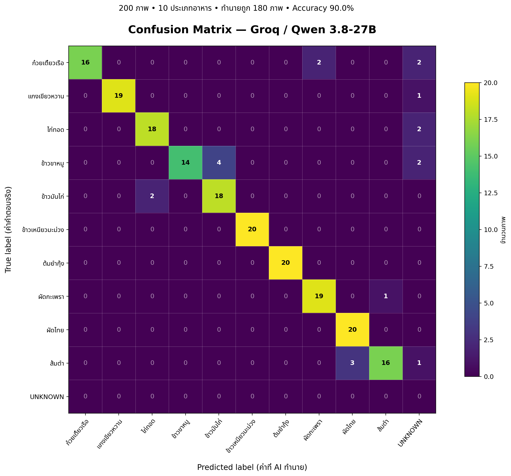

# Nouriva AI — Thai Food Image Classification (Phase 1)

> การทดลองจำแนกภาพอาหารไทยด้วย Multimodal AI ผ่าน API เพื่อประเมินความสามารถในการระบุ **ชื่อเมนูอาหาร** จากภาพ ก่อนต่อยอดสู่ระบบประเมินวัตถุดิบ ปริมาณอาหาร และโภชนาการของ Nouriva AI

**สถานะข้อมูล ณ 14 ตุลาคม 2569:** ชุดผลลัพธ์ Groq/Qwen ที่ตรวจสอบได้ครบ **200 ภาพ** ส่วนผล Gemini ที่อยู่ใน Repository ยังไม่ใช่หลักฐานสำหรับเปรียบเทียบประสิทธิภาพบน 200 ภาพอย่างเท่าเทียม

## 1. วัตถุประสงค์

1. ทดสอบการจำแนกเมนูอาหารไทยจากภาพด้วย Vision-Language Model โดยไม่ฝึกน้ำหนักโมเดลใหม่ (inference / prompting)
2. เปรียบเทียบคำตอบ AI กับป้ายกำกับจริง (`ground_truth.csv`)
3. วิเคราะห์ Accuracy, ความผิดพลาดรายประเภท และ Confusion Matrix รวมถึงคำตอบ `UNKNOWN`
4. สร้างฐานการทดลองที่ทำซ้ำได้สำหรับการศึกษาระบบ AI ด้านโภชนาการในระยะต่อไป

> **ขอบเขต:** งาน Phase 1 นี้วัดการจำแนก **ชื่ออาหาร** เท่านั้น ยังไม่ได้วัดความแม่นยำในการระบุวัตถุดิบ น้ำหนักอาหาร พลังงาน หรือสารอาหาร และยังไม่มีหลักฐานว่าเป็นการ fine-tune โมเดล

## 2. ข้อมูลที่ใช้ทดสอบ

- ภาพอาหารไทย **200 ภาพ** จาก 10 หมวดหมู่ หมวดหมู่ละ **20 ภาพ**
- ใช้ `ground_truth.csv` ระบุ `image_path` และ `ground_truth_th`
- โมเดลต้องเลือกหนึ่งชื่อจากชุดชื่อเมนูที่กำหนด หรือ `UNKNOWN` หากไม่อาจระบุอย่างสมเหตุสมผล

| เมนูอาหาร | จำนวนภาพ |
|---|---:|
| ไก่ทอด | 20 |
| แกงเขียวหวาน | 20 |
| ข้าวมันไก่ | 20 |
| ข้าวเหนียวมะม่วง | 20 |
| ก๋วยเตี๋ยวเรือ | 20 |
| ผัดไทย | 20 |
| ผัดกะเพรา | 20 |
| ส้มตำ | 20 |
| ข้าวขาหมู | 20 |
| ต้มยำกุ้ง | 20 |
| **รวม** | **200** |

**ที่มาชุดภาพ:** Repository มีไฟล์ภาพและป้ายกำกับสำหรับการทดสอบ แต่ยัง **ไม่พบเอกสารยืนยันแหล่งต้นฉบับ ผู้จัดทำ ใบอนุญาต และวิธีตรวจสอบป้ายกำกับของภาพ** จึงยังไม่ควรอ้างว่าเป็นชุดข้อมูลมาตรฐานสาธารณะชุดใดชุดหนึ่ง ก่อนใช้ในรายงานวิจัย/เผยแพร่ภาพต่อ ควรเพิ่ม URL ต้นทางและสิทธิ์ใช้ข้อมูลให้ครบ

## 3. วิธีการทดลอง

1. อ่านรายการภาพและเฉลยจาก `ground_truth.csv`
2. ส่งภาพและคำสั่งให้ AI ระบุชื่อเมนู โดยเลือกจาก **10 คลาสที่กำหนด** หรือ `UNKNOWN` เท่านั้น
3. ขอคำตอบเป็น JSON ในรูปแบบ `{"food_name":"ชื่ออาหาร"}` โดยกำชับไม่ให้ใช้ชื่อไฟล์เป็นคำใบ้
4. นำผลทำนายไปเทียบกับเฉลยแล้วบันทึก `predictions.csv` พร้อม `status` และ `raw_response`
5. ประเมินด้วย `evaluate_groq.py` และสร้างภาพ Confusion Matrix

### โมเดลและการตั้งค่า

| รายการ | ค่าที่ใช้/ตรวจพบ |
|---|---|
| ผู้ให้บริการ API ของผลชุดหลัก | Groq |
| Model ID ที่บันทึกในไฟล์ผล | `qwen/qwen3.8-27b` |
| รูปแบบทดสอบ | Zero-shot / instruction-based closed-set classification (ไม่ fine-tune) |
| Temperature ใน `main_groq.py` | `0` |
| จำนวนภาพ | 200 |
| ผลลัพธ์หลัก | `results/groq/predictions.csv` |
| สคริปต์ประเมินผล | `evaluate_groq.py` |

**หมายเหตุ:** Model ID ข้างต้นรายงานตามที่บันทึกในไฟล์ผล ไม่ใช่การรับรองชื่อรุ่นหรือความพร้อมให้บริการในปัจจุบันจากผู้ให้บริการ API

## 4. ผลการทดลองล่าสุด — Groq/Qwen

ผลจาก `results/groq/predictions.csv` ที่เผยแพร่ใน branch `ai-response-testing`:

| ตัวชี้วัด | ผล |
|---|---:|
| จำนวนภาพทั้งหมด | 200 |
| ภาพที่ `status = OK` | 200 |
| จำแนกถูกต้อง | 180 |
| จำแนกผิด/ไม่สามารถระบุได้ | 20 |
| **Accuracy** | **90.00%** |
| คำตอบ `UNKNOWN` | 8 |

**Accuracy** = จำนวนภาพที่ทำนายชื่อเมนูตรงกับเฉลย ÷ จำนวนภาพที่ประเมิน = `180 / 200 × 100 = 90.00%`

### ผลรายเมนู

| ชื่อเมนู (Ground Truth) | ถูกต้อง | ผิด/UNKNOWN | ความถูกต้องภายในเมนู |
|---|---:|---:|---:|
| ไก่ทอด | 18 | 2 | 90% |
| แกงเขียวหวาน | 19 | 1 | 95% |
| ข้าวมันไก่ | 18 | 2 | 90% |
| ข้าวเหนียวมะม่วง | 20 | 0 | 100% |
| ก๋วยเตี๋ยวเรือ | 16 | 4 | 80% |
| ผัดไทย | 20 | 0 | 100% |
| ผัดกะเพรา | 19 | 1 | 95% |
| ส้มตำ | 16 | 4 | 80% |
| ข้าวขาหมู | 14 | 6 | 70% |
| ต้มยำกุ้ง | 20 | 0 | 100% |
| **รวม** | **180** | **20** | **90%** |

> ค่ารายเมนูในตารางเป็นจำนวนทำนายถูกหารด้วยภาพจริงของเมนูนั้น (class recall) ไม่ใช่ class precision

### วิเคราะห์ความผิดพลาด

- **ข้าวขาหมู** ถูกทำนายเป็นข้าวมันไก่ 4 ภาพ และ `UNKNOWN` อีก 2 ภาพ
- **ข้าวมันไก่** ถูกทำนายเป็นไก่ทอด 2 ภาพ
- **ก๋วยเตี๋ยวเรือ** ถูกทำนายเป็นผัดกะเพรา 2 ภาพ และ `UNKNOWN` 2 ภาพ
- **ส้มตำ** ถูกทำนายเป็นผัดไทย 3 ภาพ และ `UNKNOWN` 1 ภาพ
- **ผัดกะเพรา** ถูกทำนายเป็นส้มตำ 1 ภาพ
- **ไก่ทอด** เป็น `UNKNOWN` 2 ภาพ; **แกงเขียวหวาน** เป็น `UNKNOWN` 1 ภาพ
- เมนู **ข้าวเหนียวมะม่วง ต้มยำกุ้ง และผัดไทย** ทำนายถูกครบ 20 ภาพในชุดนี้

### Confusion Matrix



- **แถว (True label)** คือชื่ออาหารตามเฉลย
- **คอลัมน์ (Predicted label)** คือชื่ออาหารที่ AI ทำนาย
- ตัวเลขตามแนวทแยงคือภาพที่ทำนายถูก
- `UNKNOWN` ต้องนับเป็นการทำนายไม่ตรงเฉลย และควรแสดงเป็นคอลัมน์ต่างหาก ไม่ปล่อยให้ภาพเหล่านี้หายไปจากการประเมิน

## 5. โครงสร้างโปรเจกต์

```text
ThaiFood-Phase1/
├── images/                      # ภาพอาหารทดสอบ 10 หมวด
├── ground_truth.csv              # เฉลยภาพ
├── main_groq.py                  # ส่งภาพทดสอบผ่าน Groq API
├── evaluate_groq.py              # คำนวณตัวชี้วัดและ Confusion Matrix
├── main.py                       # สคริปต์ทดสอบ Gemini
├── evaluate.py                   # สคริปต์ประเมินผลเบื้องต้น
├── results/
│   ├── groq/
│   │   ├── predictions.csv
│   │   └── confusion_matrix.png
│   ├── gemini/                   # ผลที่มีอยู่ ต้องตรวจความครบถ้วนก่อนเปรียบเทียบ
│   └── predictions.csv           # ผลจากสคริปต์ Gemini เดิม
├── requirements.txt
├── .env.example
└── README.md
```

## 6. วิธีรันบน Windows / VS Code

ใช้ PowerShell จากโฟลเดอร์ `ThaiFood-Phase1`:

```powershell
py -m venv .venv
.\.venv\Scripts\python.exe -m pip install -r requirements.txt
.\.venv\Scripts\python.exe -m pip install 'groq>=0.1'
```

สร้างไฟล์ `.env` ในเครื่อง (อย่าอัปโหลด API Key ขึ้น GitHub):

```dotenv
GROQ_API_KEY=YOUR_PRIVATE_GROQ_API_KEY
GROQ_MODEL=qwen/qwen3.8-27b
```

> ต้องตรวจสอบ Model ID ที่บัญชี Groq ของคุณเรียกใช้งานได้จริงก่อนรัน เพราะรุ่นที่รองรับอาจเปลี่ยนแปลงได้

```powershell
# ทดสอบเบื้องต้น 5 ภาพ
.\.venv\Scripts\python.exe main_groq.py --limit 5

# ทดสอบครบ 200 ภาพ
.\.venv\Scripts\python.exe main_groq.py --limit 0

# ประเมินผลและสร้าง Confusion Matrix
.\.venv\Scripts\python.exe evaluate_groq.py
```

**ข้อควรระวังในการรันซ้ำ:** `main_groq.py` จะข้ามภาพที่เคยบันทึก `status=OK` เมื่อ Model ID และเฉลยตรงกัน จึงไม่จำเป็นต้องเรียก API ซ้ำสำหรับภาพเดิม หากต้องการทดลองซ้ำอย่างอิสระ ให้สำรองผลเก่าและกำหนดการจัดเก็บผลแยกแต่ละรอบก่อน

## 7. ข้อจำกัดและสิ่งที่ต้องทำต่อ

- ข้อมูลมีเพียง 200 ภาพจาก 10 เมนู จึงยังสรุปความสามารถกับอาหารไทยทุกชนิดหรือภาพจากการใช้งานจริงไม่ได้
- ผลอยู่ภายใต้ชุดภาพและ prompt ที่กำหนด; อาจเปลี่ยนเมื่อใช้แสง มุมกล้อง ภาชนะ หรือรูปแบบการจัดจานอื่น
- การให้ชุดตัวเลือก 10 เมนูเป็น **closed-set classification + UNKNOWN** ไม่เท่ากับให้โมเดลระบุอาหารใดก็ได้อย่างอิสระ
- `temperature=0` ไม่รับประกันว่าผลจะเหมือนกันทุกครั้งหรือทุกเวอร์ชันโมเดล
- ผลลัพธ์ `status=OK` หมายถึงคำขอ/คำตอบผ่านขั้นตอนโปรแกรม ไม่ได้หมายความว่าคำตอบถูกต้อง
- ยังขาดเอกสารแหล่งที่มา/สิทธิ์ใช้ภาพ และกระบวนการรับรอง Ground Truth อย่างชัดเจน
- ยังไม่ควรเปรียบเทียบ Groq กับ Gemini จนกว่าจะมีผล **ครบ 200 ภาพ**, ใช้ข้อมูลและกติกาเดียวกัน และยืนยัน Model ID/เงื่อนไขการทดสอบของแต่ละโมเดล
- สำหรับการประเมินโภชนาการในระยะต่อไป ต้องมี Ground Truth ของส่วนประกอบ น้ำหนัก และพลังงานที่ตรวจสอบได้ แยกจากการประเมินชื่อเมนู

## 8. แหล่งอ้างอิง

### ข้อมูลและโค้ดการทดลอง (หลักฐานผลลัพธ์)

1. Nouriva-AI Repository, branch `ai-response-testing`: https://github.com/sarochaza/Nouriva-AI/tree/ai-response-testing
2. ผลทำนาย Groq/Qwen จำนวน 200 ภาพ (`predictions.csv`): https://github.com/sarochaza/Nouriva-AI/blob/ai-response-testing/results/groq/predictions.csv
3. ป้ายกำกับจริง (`ground_truth.csv`): https://github.com/sarochaza/Nouriva-AI/blob/ai-response-testing/ground_truth.csv
4. สคริปต์การทดลอง (`main_groq.py`): https://github.com/sarochaza/Nouriva-AI/blob/ai-response-testing/main_groq.py
5. สคริปต์ประเมินผล (`evaluate_groq.py`): https://github.com/sarochaza/Nouriva-AI/blob/ai-response-testing/evaluate_groq.py

### เอกสารเทคนิคและตัวชี้วัด

6. Groq. *Images and Vision.* https://console.groq.com/docs/vision
7. Google AI for Developers. *Image understanding — Gemini API.* https://ai.google.dev/gemini-api/docs/image-understanding
8. scikit-learn. *confusion_matrix.* https://scikit-learn.org/stable/modules/generated/sklearn.metrics.confusion_matrix.html
9. scikit-learn. *accuracy_score.* https://scikit-learn.org/stable/modules/generated/sklearn.metrics.accuracy_score.html
10. scikit-learn. *classification_report.* https://scikit-learn.org/stable/modules/generated/sklearn.metrics.classification_report.html

**ยังต้องเติม:** แหล่งอ้างอิงต้นฉบับสำหรับภาพอาหารทั้ง 200 ภาพ (ผู้จัดทำ/ชื่อ Dataset/URL/License/วันที่เข้าถึง) โดยอ้างจากแหล่งที่ใช้จริง ห้ามใส่ชื่อ Dataset ที่ไม่ได้ตรวจสอบ

---

จัดทำสำหรับการทดลองระยะที่ 1 ของ **Nouriva AI** — การระบุประเภทอาหารจากภาพ ไม่ใช่การวัดโภชนาการโดยตรง
