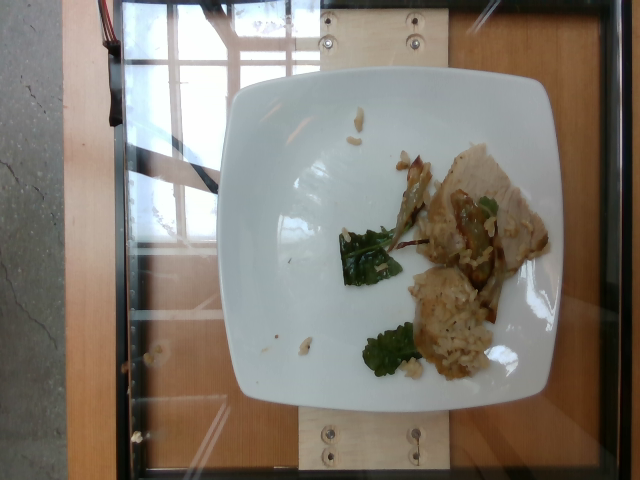
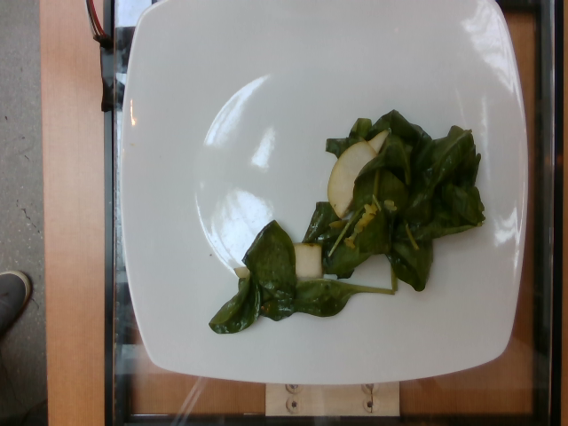
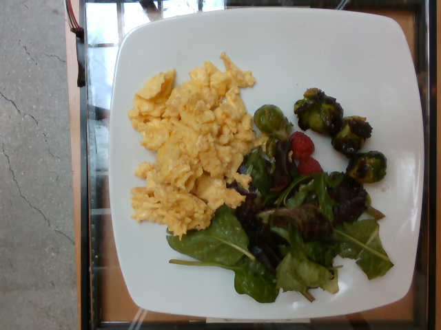
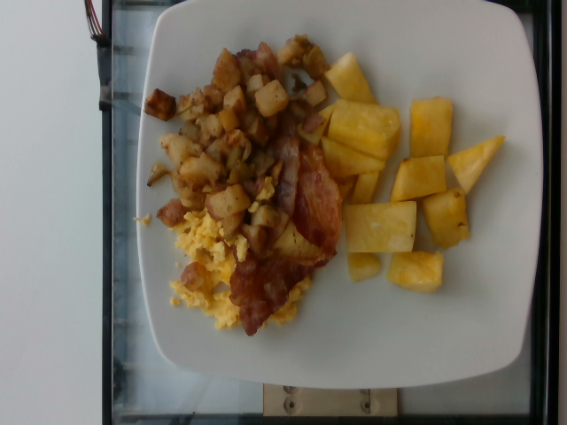
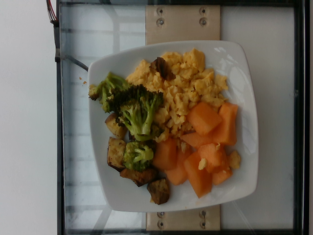

# Nouriva AI — ผลทดลองโภชนาการเบื้องต้น: Single vs Ensemble2

> **Run ID: `smoke-real-v3` · REAL API · 5 ภาพ × 3 รอบ × 2 วิธี**  
> Ensemble2 มีค่าความคลาดเคลื่อนเฉลี่ยต่ำกว่าในชุดนี้ แต่ผลเลือกวิธีเป็น **`NO_CLEAR_WINNER`** ยังไม่ยืนยันผู้ชนะ

## วัตถุประสงค์

เปรียบเทียบการวิเคราะห์ภาพอาหารเพื่อระบุวัตถุดิบ ประมาณน้ำหนัก และคำนวณพลังงานกับสารอาหาร ระหว่าง Single และ Ensemble2 โดยให้ทั้งสองวิธีเข้าถึงภาพ ฐานข้อมูล และสูตรเดียวกัน แล้วเทียบกับค่าคาดหวังจากชุดข้อมูล

Single และ Ensemble2 เป็น **วิธีทางเลือกในการทดลอง** เป้าหมายคือเลือกเพียงหนึ่งวิธีสำหรับ Nutrition Agent ในอนาคต การประสานงานแบบ Multi-Agent ในระบบ Nouriva ยังไม่ได้วัดผลในการทดลองนี้

## การออกแบบการทดลอง

| รายการ | รายละเอียด |
| --- | --- |
| ชุดทดสอบ | ภาพอาหาร 5 จานจาก `mmathys/food-nutrients` ซึ่งระบุว่าคัดมาจาก Nutrition5k |
| จำนวนรอบ | 3 รอบต่อภาพ ใช้ภาพเดิมทั้งสองวิธี |
| โมเดล | `qwen/qwen3.8-27b` ผ่าน Groq Chat Completions |
| Temperature | 0.7 |
| Single | รับคำตอบวิเคราะห์ภาพ 1 คำตอบต่อภาพต่อรอบ |
| Ensemble2 | รับคำตอบอิสระ 2 คำตอบจากโมเดลเดียวกัน แบบ self-consistency แล้วเฉลี่ยผลคำนวณ |
| สิ่งที่ควบคุมร่วมกัน | ภาพ prompt ฐานข้อมูล สูตรคำนวณ และเกณฑ์ประเมิน |
| จำนวน trial | 15 ต่อวิธี รวม 30 trial |
| ผลสุดท้าย | คำนวณครบ 30/30 trial หลัง retry; มีคู่ภาพ/รอบครบ 15 คู่ |

การเรียกสมาชิก Ensemble2 ทำตามลำดับเพื่อจัดการ rate limit สมาชิกไม่ได้อ่านคำตอบของกันและกัน จึงเป็นการรวมสองคำตอบจากโมเดลเดียวกัน ไม่ใช่การทดลองหลายรุ่นโมเดล

## กระบวนการคำนวณ

1. AI อ่านภาพและส่งรายการวัตถุดิบ สถานะการเตรียม และน้ำหนักที่ประมาณเป็น JSON
2. ระบบตรวจรูปแบบคำตอบ แล้วค้นชื่อวัตถุดิบกับสถานะใน SQLite โดยใช้ชื่อที่ normalize และ alias ที่ตรวจไว้
3. ดึงค่าโภชนาการจากฐานข้อมูลก่อนเป็นรายสารอาหาร ถ้าหาค่าที่ใช้ได้ไม่ได้จึงใช้ `AI_ESTIMATE`; ค่าที่ไม่มีทั้งสองแหล่งเป็น `null`
4. คำนวณค่ารายวัตถุดิบด้วยสูตร `น้ำหนักกรัม / 100 × ค่าโภชนาการต่อ 100 กรัม` แล้วรวมเป็นค่าต่อจาน
5. สำหรับ Ensemble2 เฉลี่ย contributions ของสองสมาชิก วัตถุดิบที่พบในสมาชิกเดียวเฉลี่ยกับ contribution 0 ของสมาชิกที่ไม่พบ
6. เปรียบเทียบผลกับ Expected Result และคำนวณตัวชี้วัด

`COMPLETE_WITH_ESTIMATES` หมายถึงคำนวณค่าที่ต้องใช้ครบและมีค่า AI ประมาณร่วมด้วย สถานะนี้ไม่ได้รับรองว่าคำตอบตรงกับค่าคาดหวัง

## ฐานข้อมูลวัตถุดิบ

ไฟล์: [`nutrition_database/ingredients.sqlite`](experiments/nutrition-candidates-v3/nutrition_database/ingredients.sqlite)

| แหล่งข้อมูล | จำนวนรายการ |
| --- | ---: |
| FNDDS:2021–2023 | 5,432 |
| Foundation:2025–12 | 436 |
| SR Legacy:2018–04 | 7,793 |
| **รวม** | **13,661** |

มี alias 46 รายการ ฐานข้อมูลเป็นข้อมูลโภชนาการวัตถุดิบ แยกจากชุดภาพและ Expected Result การมีรายการในฐานข้อมูลไม่ได้หมายความว่าระบบจับคู่ชื่อที่ AI ตอบได้ทุกครั้ง

Database SHA-256: `184878fc11046883d9c344ad321deeb8e3eff9f70f8c4a4c50ec50667e3aea49`

## ผลเปรียบเทียบรวม

รายงานใช้คู่ภาพ/รอบที่ทั้งสองวิธีคำนวณครบ ค่า MAE คือความคลาดเคลื่อนสัมบูรณ์เฉลี่ย ยิ่งต่ำยิ่งดี ส่วน Ingredient F1 ยิ่งสูงยิ่งดี

| ตัวชี้วัด | Single | Ensemble2 |
| --- | ---: | ---: |
| Trial ที่ประเมินได้ | 15/15 | 15/15 |
| kcal MAE (kcal) | 65.3684 | 39.8298 |
| Protein MAE (g) | 2.5612 | 2.2497 |
| Carbs MAE (g) | 8.6685 | 6.1370 |
| Fat MAE (g) | 3.9010 | 3.0539 |
| น้ำหนักรวม MAE (g) | 51.4667 | 39.7333 |
| Ingredient F1 | 0.2420 | 0.2298 |
| คะแนนความคลาดเคลื่อนหลัก | 0.433090 | 0.342108 |
| HTTP attempts รวม retry | 43 | 82 |
| สัดส่วนมวลที่มีค่า DB เฉลี่ย | 4.92% | 11.58% |

Ensemble2 มี MAE ของพลังงานและสารอาหารทั้งสี่ตัวต่ำกว่า แต่ Ingredient F1 ต่ำกว่า Single เล็กน้อย และมี HTTP attempts ประมาณ 1.91 เท่าของ Single จำนวน attempts รวมการเรียกที่ retry จึงไม่เท่ากับจำนวนคำตอบที่วางแผนไว้ ไม่สามารถสรุปค่าใช้จ่ายเงินจริงจากจำนวนนี้เพียงอย่างเดียว

## Expected Result เทียบผลเฉลี่ยรายจาน

Expected มาจาก labels ของชุดข้อมูล ไม่ได้สร้างจากคำตอบ AI ค่าโภชนาการอ้างอิงของ Nutrition5k คำนวณจากวัตถุดิบและน้ำหนักร่วมกับข้อมูลโภชนาการ ไม่ใช่ผลตรวจในห้องปฏิบัติการของแต่ละภาพ

ค่าของ Single และ Ensemble2 ในตารางนี้เป็น **ค่าเฉลี่ยจาก 3 รอบของจานเดียวกัน**; ค่ารายรอบดูได้ใน `per_evaluation.csv` ตัวเลขแสดง 3 ตำแหน่งทศนิยม

| Dish ID | แหล่งค่า | น้ำหนัก (g) | kcal | Protein (g) | Carbs (g) | Fat (g) |
| --- | --- | ---: | ---: | ---: | ---: | ---: |
| `dish_1560368944` | Expected | 66.000 | 143.540 | 13.566 | 2.141 | 8.573 |
| `dish_1560368944` | single เฉลี่ย 3 รอบ | 117.000 | 169.103 | 12.149 | 18.592 | 4.730 |
| `dish_1560368944` | ensemble2 เฉลี่ย 3 รอบ | 103.167 | 161.193 | 12.646 | 14.984 | 5.396 |
| `dish_1561491121` | Expected | 28.000 | 31.457 | 0.566 | 1.183 | 2.924 |
| `dish_1561491121` | single เฉลี่ย 3 รอบ | 68.000 | 49.420 | 1.442 | 4.525 | 3.198 |
| `dish_1561491121` | ensemble2 เฉลี่ย 3 รอบ | 79.167 | 53.713 | 1.739 | 4.938 | 3.596 |
| `dish_1561654374` | Expected | 251.000 | 326.356 | 19.444 | 13.121 | 22.061 |
| `dish_1561654374` | single เฉลี่ย 3 รอบ | 245.000 | 262.133 | 15.677 | 11.210 | 17.453 |
| `dish_1561654374` | ensemble2 เฉลี่ย 3 รอบ | 224.167 | 244.858 | 15.588 | 10.740 | 15.303 |
| `dish_1563555605` | Expected | 403.000 | 537.810 | 24.804 | 39.622 | 31.371 |
| `dish_1563555605` | single เฉลี่ย 3 รอบ | 333.333 | 629.800 | 25.955 | 50.660 | 36.084 |
| `dish_1563555605` | ensemble2 เฉลี่ย 3 รอบ | 334.167 | 552.483 | 25.285 | 44.041 | 30.927 |
| `dish_1563900205` | Expected | 301.000 | 262.262 | 12.863 | 21.506 | 14.249 |
| `dish_1563900205` | single เฉลี่ย 3 รอบ | 295.000 | 273.883 | 14.453 | 23.917 | 13.342 |
| `dish_1563900205` | ensemble2 เฉลี่ย 3 รอบ | 302.667 | 297.108 | 16.295 | 22.651 | 15.722 |

## ภาพที่ใช้ทดสอบ

ไฟล์ต้นฉบับอยู่ใน [`results/real/smoke-real-v3/test-images/`](experiments/nutrition-candidates-v3/results/real/smoke-real-v3/test-images/)

| Dish ID | ภาพ |
| --- | --- |
| `dish_1560368944` |  |
| `dish_1561491121` |  |
| `dish_1561654374` |  |
| `dish_1563555605` |  |
| `dish_1563900205` |  |

## การตัดสินผู้ชนะ

คะแนนหลักเฉลี่ยความคลาดเคลื่อนของ kcal, protein, carbs และ fat หลังหารด้วย `max(Expected, floor)` โดย floor คือ kcal 50 และสารอาหารแต่ละตัว 5 g คะแนนนี้ไม่ใช่เปอร์เซ็นต์ความแม่นยำ

เกณฑ์เลือกวิธีกำหนดให้มีอย่างน้อย 5 ภาพและ 3 รอบ อัตราคำนวณครบแต่ละวิธีอย่างน้อย 90% จานที่จับคู่ครบทุก round อย่างน้อย 80% และอย่างน้อย 5 จาน จากนั้นต้องได้คะแนนดีขึ้นอย่างน้อย 5% และช่วงความเชื่อมั่น 95% ของผลต่างไม่คร่อมศูนย์

| รายการ | ผล |
| --- | --- |
| วิธีที่คะแนนเฉลี่ยต่ำกว่า | Ensemble2 |
| คะแนนหลักลดลงจาก Single | 21.01% |
| CI95 ของผลต่าง Ensemble2 − Single | −0.2053607061 ถึง +0.0000781632 |
| หน่วย bootstrap | จาน หลังเฉลี่ย 3 รอบ; สุ่มซ้ำ 2,000 ครั้ง |
| ผลเลือกวิธี | **NO_CLEAR_WINNER** |
| วิธีที่เลือก | **ยังไม่มี (`selected_method = null`)** |

แม้คะแนนเฉลี่ยลดลงเกิน 5% แต่ช่วงความเชื่อมั่นยังคร่อมศูนย์ จึงยังไม่ผ่านเกณฑ์ยืนยันผู้ชนะ การทำ 3 รอบของภาพเดิมไม่ได้เพิ่มเป็น 15 ภาพอิสระ

## ข้อจำกัดและสิ่งที่ควรทดลองต่อ

- มีเพียง 5 จาน จึงใช้แสดงความเป็นไปได้และแนวโน้มเบื้องต้น ควรยืนยันด้วยภาพชุดใหม่ที่ไม่ใช้ปรับระบบ
- สัดส่วนมวลที่มีค่า DB เฉลี่ยเพียง 4.92% และ 11.58% ผลคำนวณส่วนใหญ่ยังพึ่งค่าประมาณ AI ตัวเลขนี้ไม่ใช่สัดส่วนพลังงานจาก DB และยังสรุปประโยชน์ด้านความแม่นยำของ DB แยกต่างหากไม่ได้
- การอ่านชนิดวัตถุดิบ น้ำหนัก และการจับคู่ชื่อฐานข้อมูลล้วนทำให้ผลคลาดเคลื่อนได้ Ingredient F1 ใช้ชื่อที่ normalize และ synonym จำกัด ไม่ได้จับความหมายอัตโนมัติ
- ค่า 30/30 เป็นผลสุดท้ายหลัง retry ไม่ใช่อัตราสำเร็จในการเรียกครั้งแรก เคยพบ rate limit และคำตอบที่ไม่ผ่าน schema โดยเก็บประวัติไว้
- Ensemble2 ใช้สองคำตอบต่อภาพต่อรอบ จึงใช้งบการเรียกต่างจาก Single ผลนี้ไม่ใช่การเปรียบเทียบภายใต้งบเท่ากัน
- การทดลองนี้ยังไม่ได้ทดสอบอาหารไทยเป็นตัวแทนทั้งระบบ การประสานงาน Multi-Agent หรือคำแนะนำโภชนาการตามโรค
- ควรเพิ่มภาพทดสอบ ปรับการระบุวัตถุดิบ/น้ำหนักและ alias ที่ตรวจแล้ว จากนั้นทดลองใหม่ด้วย Run ID ใหม่เมื่อ code/config/DB เปลี่ยน

## ไฟล์หลักฐาน

| ไฟล์/โฟลเดอร์ | เนื้อหา |
| --- | --- |
| [report.html](experiments/nutrition-candidates-v3/results/real/smoke-real-v3/comparison/report.html) | รายงาน HTML เปิดใน browser หลังดาวน์โหลด/clone |
| [report.md](experiments/nutrition-candidates-v3/results/real/smoke-real-v3/comparison/report.md) | รายงานอ่านบน GitHub |
| [per_evaluation.csv](experiments/nutrition-candidates-v3/results/real/smoke-real-v3/comparison/per_evaluation.csv) | Expected และผลทำนายครบทุกภาพ/รอบ/วิธี |
| [ingredient_breakdown.csv](experiments/nutrition-candidates-v3/results/real/smoke-real-v3/comparison/ingredient_breakdown.csv) | วัตถุดิบ น้ำหนัก และแหล่งค่ารายสารอาหาร |
| [summary.json](experiments/nutrition-candidates-v3/results/real/smoke-real-v3/comparison/summary.json) | ตัวชี้วัดรวมและ cohort |
| [winner_selection.json](experiments/nutrition-candidates-v3/results/real/smoke-real-v3/comparison/winner_selection.json) | เกณฑ์และผลเลือกวิธี |
| [records/](experiments/nutrition-candidates-v3/results/real/smoke-real-v3/records/) | Trial JSON และประวัติ retry |
| [frozen.json](experiments/nutrition-candidates-v3/results/real/smoke-real-v3/frozen.json) | Configuration และ hashes ของชุดทดลอง |
| [test-images/](experiments/nutrition-candidates-v3/results/real/smoke-real-v3/test-images/) | ภาพทดสอบต้นฉบับ 5 ภาพ |

ชุดหลักฐานที่นำมาสรุปมี Expected totals ในไฟล์ประเมิน แต่ไม่มี `ground_truth.json` ฉบับเต็มและ prepared manifest ต้นฉบับ จึงไม่สร้าง expected ingredient labels ขึ้นใหม่จากคำตอบ AI

## แหล่งข้อมูล

- ชุดภาพและ labels: https://huggingface.co/datasets/mmathys/food-nutrients
- Nutrition5k: https://github.com/google-research-datasets/Nutrition5k
- เอกสารฐานข้อมูล USDA FoodData Central: https://fdc.nal.usda.gov/data-documentation/

README นี้สรุปผลจากไฟล์หลักฐานของ `smoke-real-v3` และจัดลิงก์สำหรับวางเป็น `README.md` ที่หน้าหลัก repository โดยชุดทดลองอยู่ใน `experiments/nutrition-candidates-v3/`
